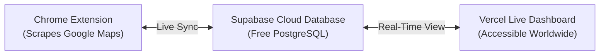

# 🚀 Zen Scrapper - Live Cloud Database & Vercel Deployment Guide
**Agency:** Zenthoz Digital Marketing ([www.zenthoz.com](https://www.zenthoz.com) • +1 307 301 2270)  
**Author:** Iqam Ifthikar  

This guide shows you how to connect **Zen Scrapper** to a **free live cloud database (Supabase PostgreSQL)** and deploy your **Live Web Dashboard on Vercel** so that:
1. **The Chrome Extension** continues scraping Google Maps locally from your browser with zero rate-limits.
2. Any newly scraped leads, edits, deep search audits, or pitch notes **automatically sync to your cloud database**.
3. You and your agency team at **Zenthoz Digital Marketing** can open your dashboard online (e.g. `https://zen-scrapper.vercel.app`) from any laptop, Mac, phone, or tablet worldwide and view, filter, and export leads in real time!

---

## ⚡ Quick 3-Step Setup



---

### Step 1: Set Up Free Supabase Database (Takes 60 seconds)

1. Go to **[supabase.com](https://supabase.com)** and create a free account.
2. Click **"+ New Project"**:
   - **Name:** `zen-scrapper`
   - **Database Password:** (Generate and save a strong password)
   - **Region:** Choose the region closest to you (e.g., London / Frankfurt / US East).
   - Click **"Create new project"**.
3. In your Supabase Project dashboard, click **"SQL Editor"** on the left menu.
4. Click **"+ New Query"**, open [`supabase_schema.sql`](file:///C:/Users/NewGen/.gemini/antigravity/scratch/lead-scraper-extension/supabase_schema.sql), copy its entire content, paste it into the editor, and click **"Run"**.
   - ✅ *This creates your `sessions` and `leads` tables with high-performance indexes and real-time live replication.*
5. In Supabase, go to **Project Settings ➔ API**:
   - Copy your **Project URL** (e.g., `https://abcdefghijklm.supabase.co`)
   - Copy your **Project API Key (`anon` / `public`)**

---

### Step 2: Connect Zen Scrapper Extension to Cloud DB

1. Open your **Zen Scrapper Dashboard** in Chrome.
2. Click **"⚙️ Settings"** (top right) or the **"☁️ Live Cloud"** button.
3. Scroll down to the **☁️ Live Cloud Database (Supabase & Vercel)** box:
   - Paste your **Supabase Project URL**.
   - Paste your **Supabase Anon Public Key**.
   - Click **"⚡ Test Connection"** ➔ You will see `🟢 Successfully connected to Supabase PostgreSQL database!`.
   - Click **"🔄 Sync to Cloud"** to push all your existing search campaigns and leads to the cloud.
   - Click **"Save Settings"**.
4. The top bar will now show **`☁️ Cloud: Active`** with a green badge! Every lead you scrape or edit will now be saved in the cloud.

---

### Step 3: Deploy Live Web Dashboard to Vercel (Takes 2 minutes)

You can deploy the Zen Scrapper web dashboard to Vercel for free with a custom URL:

#### Option A: 1-Click via GitHub + Vercel
1. Initialize a Git repository and push this directory (`scratch/lead-scraper-extension`) to GitHub:
   ```bash
   git init
   git add .
   git commit -m "Initial Zen Scrapper release with cloud sync"
   git remote add origin https://github.com/your-username/zen-scrapper.git
   git push -u origin main
   ```
2. Go to **[vercel.com](https://vercel.com)** and log in with GitHub.
3. Click **"Add New... ➔ Project"** and select your `zen-scrapper` repository.
4. Leave all default settings (the included `vercel.json` and `package.json` will automatically configure routing).
5. Click **"Deploy"**.
6. In ~20 seconds, your dashboard is live at:
   ```text
   https://zen-scrapper.vercel.app
   ```

#### Option B: Deploy via Vercel CLI (Direct from Terminal)
If you have Node.js and the Vercel CLI installed:
```bash
npm install -g vercel
cd scratch/lead-scraper-extension
vercel
```
Follow the prompts (accept defaults). Your live URL will be ready immediately!

---

## 🔄 How the Real-Time Sync Works

| Action | What Happens |
| :--- | :--- |
| **Scraping on Google Maps** | Leads are captured locally in Chrome for speed and automatically pushed to your Supabase PostgreSQL database. |
| **Editing or Adding Notes** | When you edit a phone, add an audit note, or run Deep Search, it immediately updates the database. |
| **Viewing on Vercel** | Opening your Vercel URL on any computer or mobile browser displays your live leads directly from Supabase. |
| **Offline Fallback** | If you don't enter cloud credentials or work offline, Zen Scrapper seamlessly uses local Chrome storage with zero interruption. |

---

## 🛡️ Security & Privacy
- **Row Level Security (RLS)** is enabled on all tables.
- Only your Supabase Project Anon Key is required—no dangerous master service keys are ever exposed in client code.
- You have complete control over your own private database.
