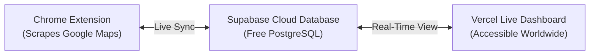

# 🚀 Zen Scrapper - Live Cloud Database & Vercel Deployment Guide
**Agency:** Zenthoz Digital Marketing ([www.zenthoz.com](https://www.zenthoz.com) • +1 307 301 2270)  
**Author:** Iqam Ifthikar  

This guide shows you how to connect **Zen Scrapper** to a **free live cloud database (Supabase PostgreSQL)** and deploy your **Live Web Dashboard on Vercel** so that:
1. **The Chrome Extension** continues scraping Google Maps locally from your browser with zero rate-limits.
2. Any newly scraped leads, edits, deep search audits, or pitch notes **automatically sync to your cloud database**.
3. You and your agency team at **Zenthoz Digital Marketing** can open your dashboard online (e.g. `https://zen-scrapper.vercel.app`) from any laptop, Mac, phone, or tablet worldwide and view, filter, and export leads in real time!

---

## ⚡ Quick 3-Step Setup



---

### Step 1: Set Up Free Supabase Database (Takes 60 seconds)

1. Go to **[supabase.com](https://supabase.com)** and create a free account.
2. Click **"+ New Project"**:
   - **Name:** `zen-scrapper`
   - **Database Password:** (Generate and save a strong password)
   - **Region:** Choose the region closest to you (e.g., London / Frankfurt / US East).
   - Click **"Create new project"**.
3. In your Supabase Project dashboard, click **"SQL Editor"** on the left menu.
4. Click **"+ New Query"**, open [`supabase_schema.sql`](file:///C:/Users/NewGen/.gemini/antigravity/scratch/lead-scraper-extension/supabase_schema.sql), copy its entire content, paste it into the editor, and click **"Run"**.
   - ✅ *This creates your `sessions` and `leads` tables with high-performance indexes and real-time live replication.*
5. In Supabase, go to **Project Settings ➔ API**:
   - Copy your **Project URL** (e.g., `https://abcdefghijklm.supabase.co`)
   - Copy your **Project API Key (`anon` / `public`)**

---

### Step 2: Preconfigured Cloud DB & Admin Account

Your Supabase project credentials are now preconfigured directly into the codebase:
- **Project URL:** `https://yvyzaxvslbtilcaalwdw.supabase.co`
- **Anon Public Key:** `eyJhbGciOiJIUzI1NiIsInR5cCI6IkpXVCJ9...`
- **Admin Account:** `zenthoztechnologies@gmail.com`
- **Password:** `Zentech@400`

Neither you nor your staff need to manually type keys into the settings—it is configured out of the box!

---

### Step 3: Deploy Live Web Dashboard to Vercel (1-Click)

The repository is already connected and pushed to GitHub at:
👉 **[https://github.com/iqam101/zen-scrapper](https://github.com/iqam101/zen-scrapper)**

To deploy to Vercel:
1. Go to **[vercel.com/new](https://vercel.com/new)** and log in with your GitHub account.
2. Select your repository: **`iqam101/zen-scrapper`**.
3. Leave all default settings (the included `vercel.json` and `package.json` configure everything automatically).
4. Click **"Deploy"**.
5. In ~20 seconds, your live dashboard will be active at:
   ```text
   https://zen-scrapper.vercel.app
   ```
6. Every time you ask for code updates, changes pushed to GitHub will automatically deploy to Vercel!

---

### 👥 Team Authentication & Role-Based Access Control

| Role | Access Level | Permissions |
| :--- | :--- | :--- |
| **👑 Administrator** (`zenthoztechnologies@gmail.com`) | Full System Control | Scrape leads, Deep Search, Export CSV/Google Contacts, **Access ⚙️ Settings**, change branding/pitch settings, and **Create or Remove Staff Users**. |
| **👤 Staff Member** (e.g. `staff@zenthoz.com`) | Operational Scraper | Scrape leads on Google Maps, run Deep Search audits, view search history, filter by niche or "No Website", generate pitches, and export leads. **⚙️ Settings are hidden and blocked** to protect agency keys and configs. |

---

## 🔄 How the Real-Time Sync Works

| Action | What Happens |
| :--- | :--- |
| **Scraping on Google Maps** | Leads are captured locally in Chrome for speed and automatically pushed to your Supabase PostgreSQL database. |
| **Editing or Adding Notes** | When you edit a phone, add an audit note, or run Deep Search, it immediately updates the database. |
| **Viewing on Vercel** | Opening your Vercel URL on any computer or mobile browser displays your live leads directly from Supabase. |
| **Offline Fallback** | If you don't enter cloud credentials or work offline, Zen Scrapper seamlessly uses local Chrome storage with zero interruption. |

---

## 🛡️ Security & Privacy
- **Row Level Security (RLS)** is enabled on all tables.
- Only your Supabase Project Anon Key is required—no dangerous master service keys are ever exposed in client code.
- You have complete control over your own private database.
